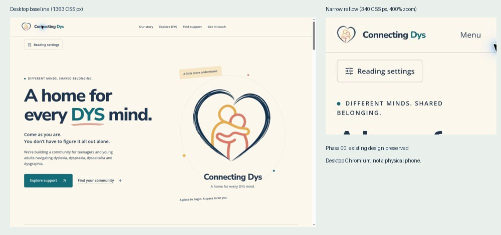

# Phase 00 — Audit, baselines and scene contracts

Completed 14 November 2026, with browser coverage limits explicitly recorded below. Source reference: `master`, `d45aeff2c9b0148c9b3cb6db72613f35ebf595fb` (13 November, “Keep the largest reading settings within narrow viewports”). **No application code, layout, copy, logo, font assets or motion behaviour changed.** Phase 01 has not started.

## Deliverables and source review

Read all eight current project Markdown attachments, repository `AGENTS.md`, README, `docs/FOUNDATION_AUDIT.md`, `docs/QA.md`, `docs/CONTENT_SOURCES.md`, homepage, global CSS, story artwork/motion, Lenis provider, preferences/bootstrap, header/menu/footer, content routes/data, production tests, package/lock/config and the latest eight commits. Read the installed Next.js Playwright guide before adding test tooling.

The newer roadmap supersedes the original build prompt’s new-repository/provisional-logo wording: work in **jonathan-hansel-awo/connecting-dys**, preserve Marie’s approved original identity and exact tagline, and do not invoke/configure Vercel. The current roadmap is now available at [HOMEPAGE_ENHANCEMENT_ACTION_PLAN.md](HOMEPAGE_ENHANCEMENT_ACTION_PLAN.md).

- [Scene contracts](SCENE_CONTRACTS.md): seven chapters, DOM order, animated targets, trigger distances, fallbacks, focus destinations, refresh/teardown requirements and selector risks.
- [Baseline evidence](baselines/phase-00/README.md): screenshots, capture metadata, font/background samples, limited scroll samples and HTTP route/link results.
- `playwright.config.ts` and `tests/browser/homepage.spec.ts`: reuse existing Playwright and axe packages; six viewport projects, five browser scenarios, production-server ownership and screenshots/traces. No dependencies or lockfile changes.
- `tests/production.test.ts`: add scene-order/hook/decorative-scope/navigation/toolbar regression group; protect the existing symbol adaptation’s SHA-256 as well as the full logo.

## Before / after and motion summary

Before and after are intentionally the **same homepage**. Desktop keeps its artwork-only connection pin; compact layouts keep native-flow, unpinned artwork/image scrubs. No texture, overlap choreography or game was introduced. The separate Reading settings toolbar remains below the sticky header.



## Visual reference and browser scope

Captured the existing public site at `https://connecting-dys.vercel.app/` in cloud Chromium. It has the expected seven chapters, human recognition image/caption, original logo, toolbar and scene hooks. **The live deployment’s exact Git SHA was not exposed/verified; these are live-site references, not screenshots of the local production build.** Local application sources/assets are unchanged from the source reference above.

| Baseline | Measured CSS viewport | Method | Evidence |
| --- | --- | --- | --- |
| Desktop | 1363 × 936 | Native 100% zoom, fine pointer | 13 sequential viewport frames through footer; settled hero, pinned community, ending, dialog |
| Tablet-width | 779 × 535 | 175% desktop browser zoom | 22 sequential viewport frames through footer; dialog |
| Wide mobile-width | 454 × 312 | 300% desktop browser zoom | 53 sequential viewport frames through footer; dialog |
| Narrow mobile-width | 340 × 234 | 400% desktop browser zoom | 101 sequential viewport frames through footer; hero, recognition, community, dialog and maximum-settings dialog |

These are **reflow references**, not device emulation, touch momentum tests, or an exact 360/430px portrait matrix. The browser’s full-page capture path cropped zoomed layouts, so those incomplete captures were discarded. They are replaced by **189 sequential viewport screenshots covering each journey through the footer**, with per-frame scroll/viewport measurements; separate settled hero/settings captures provide detail. These are visual references, not a pixel-diff assertion or a continuous video. Physical phone portrait/landscape and exact emulator viewports remain unverified. The new runner defines 360×800, 430×932, 768×1024, 1440×900, 844×390 and 320×800 for repeatable future checks.

All four default reflow layouts measured no page-level horizontal overflow. The recognition frame clips the scaled image and keeps the caption/copy in normal flow. At narrow width the figure/art-to-copy gap was **36 CSS px** for each of the five font choices, across all four backgrounds (20 combinations). Maximum size/spacing gave **52px** separation and no dialog overflow; see the small page-overflow finding below.

Desktop scrolling showed the artwork at approximately y=140px with one pin spacer and a completed path. Compact samples had no pin spacers; the two close samples did not cross the artwork’s active interval and showed **no measurable path progression**. They do not prove the desired future mobile scene change. Source inspection confirms compact GSAP scrubs exist; stronger perceived scene progression remains Phase 02–04 work.

## Functional, identity and preference baseline

| Item | Result / evidence |
| --- | --- |
| Routes | Production HTTP GET returns 200 and expected H1 on `/`, `/about`, `/support`, `/contact`, `/get-involved`, `/accessibility`, `/dyslexia`, `/dyspraxia`, `/dyscalculia`, `/dysgraphia`. Existing production tests traverse all rendered internal links/fragments. |
| Unknown route | `/phase00-does-not-exist` returned HTTP 200. App calls `notFound()` inside the dynamic/streamed route; assess rendered error/robots and desired status behaviour separately. Do not count this probe as a working content route. |
| External links | All nine distinct Base44 destinations returned HTTP 200: OurPolicies, Support, Contact, GetInvolved, Partner and four topic pages. This verifies HTTP reachability only; SPA content, policies, forms and service delivery were not validated. No email was sent. |
| Full approved logo | SHA-256 `bb68edef8faee420c861661d3b1f19e06db8c12dc17060d01a3deb4caba1112b`; unchanged. |
| Existing header/hero symbol | SHA-256 `a0126d9aa517efc994eb72af77d2eea45d580e1ba85fb2d8d0fdcc7d64875e6f`; unchanged; now regression-protected. |
| Tagline/content | `A home for every DYS mind.` in content config/HTML/metadata; UK CIC, Marie Johnson, Nottingham/nationwide and “full services are not yet being delivered” preserved. No invented voices, events, statistics or member-photo claims. |
| Header/toolbar | Sticky opaque header; non-sticky toolbar in separate normal-flow block; native home anchor `/#page-start`. Source and browser inspected. |
| Fonts/backgrounds | UI exercised all five fonts × all four backgrounds at 340px narrow reflow. Chosen CSS variable/spacious state and geometry recorded in `preferences.json`. CSS selection alone does not prove system Arial/Verdana are installed; optional font failure is not browser-tested. |
| Reduced motion/persistence | Site Reduce decorative motion + maximum OpenDyslexic settings survive reload. Observed no Lenis class, no pin spacer, no photo transform. OS reduced-motion is source/test-bootstrap inspected, **not changed in the live browser**. |
| Dialog/focus/anchors | Dialog opens focused on Close; Escape returns focus to Reading settings. Recognition anchor landed below the sticky header (about 126px versus header bottom 70px at narrow width). Full keyboard cycle, screen reader and Back/Forward interactions remain unverified in this session. |
| Console | No warnings/errors returned by the browser log filter for `connecting-dys.vercel.app`. Unfiltered logs contain browser-extension metadata errors; these are environment noise, not application errors. This is a limited log sample, not proof of a globally error-free browser session. |
| No-JS/native fallback | Production HTML/structural tests pass without app script execution. Real no-JS browser session and coarse-pointer touch were not executed. Desktop zoom retains a fine pointer and may keep Lenis active. |
| Texture | No texture preference yet; on/off is **not applicable until Phase 01**, not a missing Phase 00 implementation. |

## Motion and lifecycle audit

The detailed implementation contract is in [SCENE_CONTRACTS.md](SCENE_CONTRACTS.md). Important findings for later edits:

- Correct existing safeguards: desktop width/height/pointer conditions, OS/personal reduced motion, spacious early exit, decorative-only pin, natural reading order, one GSAP→Lenis frame clock, native anchors/keyboard/history interruption and generation-safe asynchronous import cleanup.
- Current global scene selectors can silently fail or target duplicates when CSS/components change. Keep selector cardinality or migrate to scoped refs deliberately.
- Pin start is a fixed 140px, while duration is derived from actual chapter/art heights. New geometry must be measured under zoom/font/spacing changes.
- Provider responds to body resize, font ready/loadingdone, image load, pageshow and route changes. Those refresh measurements; a full scene rebuild currently happens on preference/media changes. Phase 04’s broader teardown/rebuild requirement needs explicit attention.
- Forced-colours CSS improves borders, but does **not** disable Lenis/GSAP or suppress all relief. Address that with Phase 01’s static forced-colours surface contract.
- Preserve the recognition fix: contained 3:2 image, normal-flow caption, positive grid gap and `min-width:0`. The prior negative margins/visible SVG overflow must not return.

## Findings and exact follow-up boundaries

| ID | Finding | Follow-up |
| --- | --- | --- |
| P00-01 | At 340px/400% zoom with OpenDyslexic 26px, line-height 2, letter spacing .12em and soft peach, document scrollWidth was **343px vs 337px clientWidth**. Dialog itself stayed contained; bounding-box scan found no obvious overflowing element. | Reproduce at exact 320/360 widths and real zoom; inspect text/pseudo-element/outline overflow before changing styles. Resolve during Phase 01 preference-safe surface work and retest at Phase 06. No clipping patch added in this audit phase. |
| P00-02 | Forced colours is not a JS motion disable condition. | Phase 01: static surfaces/relief suppression and align motion guards; then browser forced-colours verification. |
| P00-03 | Compact path samples did not demonstrate progression; existing short/touch effects remain subtle. | Phase 02 hero transition; Phase 03 sequential discovery; Phase 04 progression tied to three real chapter beats. Do not enable touch Lenis merely for animation. |
| P00-04 | Local browser cannot launch; exact viewport/axe/lifecycle matrix cannot be executed here. | Run `npm run test:browser` on a browser-capable machine before treating that suite as passed. Keep the measured cloud-zoom evidence separate. |
| P00-05 | Unknown-slug response is HTTP 200 with streamed notFound handling. | Review rendered error/robots/status semantics in a separate routing check; not a homepage redesign change. |

## Commands and actual results

Runtime: Node **24.22.1**, npm **11.9.0**. Clean checkout/lockfile, no dependency edits.

| Command / check | Actual result |
| --- | --- |
| `npm ci` | PASS; 588 packages installed. npm environment/deprecation notices only. |
| `npm run typecheck` | PASS (including new browser config/spec). |
| `npm run lint` | PASS (including new tooling). |
| `npm run build` | PASS; all existing public pages generated. Re-run after tooling changes; application source unchanged. |
| `npm test` before edits | PASS: **8/8** groups. |
| `npm test` after additions | PASS: **9/9** groups, including scene contracts and both brand asset hashes. |
| Production HTTP traversal | PASS for ten existing routes and nine external HTTP destinations; JSON evidence recorded. Separate unknown-slug finding above. |
| `npx playwright test --list` | PASS: 30 discovered project/scenario entries; route-only scenario skips five non-desktop projects when executed. Discovery is not execution. |
| `npm run test:browser -- --project=desktop --grep 'chapter screenshots'` | **BLOCKED / launch failure**, missing Playwright headless browser. No browser test body ran. |
| `npx playwright install chromium` | FAILED: download returned invalid/truncated ZIP after installer retries. |
| Installed `/usr/bin/chromium` launch | FAILED: AF_UNIX socket denied (`Operation not permitted`) before a page opened. No sandbox escalation used. |
| Cloud Chromium UI fallback | EXECUTED: four width/zoom references, dialog, 20 font/background combinations, maximum settings, site reduced motion/reload, native anchor, desktop pin and limited console/scroll samples. |
| `git diff --check` | PASS. |

One verification attempt overlapped a rebuild with production HTML tests and failed on missing build files. Tests were rerun sequentially after build completion; use that order because the suite reads `.next/server/app/*.html`.

The standalone `npm start` process could not be reached from a later isolated executor invocation. A local production server **was successfully spawned and queried within one Node process** for the HTTP evidence; Playwright’s managed production webServer also reached readiness before browser launch failed. The older managed `--host/--strictPort` preview issue was not used as the test path here.

Not executed: full rendered-browser axe (jsdom structural axe still passes), Lighthouse/Core Web Vitals, physical Android/iOS touch or momentum, exact 320px emulator, landscape device rotation, actual OS reduced motion/forced colours, full keyboard trap/Back/Forward/history restoration, optional-font failure, screen-reader or real-user review, mail delivery and external form submission. No WCAG certification claim.

## Reuse and next phase

```bash
npm ci
npm run build
npm test
npx playwright install chromium   # in a browser-capable environment
npm run test:browser
# Optional installed browser, without changing source:
PLAYWRIGHT_CHROMIUM_EXECUTABLE_PATH=/usr/bin/chromium npm run test:browser
```

The browser runner starts its own **local production server** on port 3100 and writes screenshots, failure traces, axe attachments and HTML report to ignored `test-results/` and `playwright-report/`. It does not silently overwrite committed Phase 00 evidence and does not contact a deployment API. Review its screenshots before accepting later phases; this is smoke coverage, not pixel-diff certification.

Phase 01 is next, only on the owner’s instruction: continuous fine texture/surface tokens, existing preference schema/bootstrap extension, texture toggle, background compatibility and the documented narrow/forced-colours findings. Approved assets/copy/navigation stay fixed. Phases 02–05 add the bounded scene changes, Phase 06 performs the full release gate, and the optional game remains Phase 07.

Source commit/push is authorised. No Vercel command/API/configuration is used. An existing owner-controlled GitHub integration may automatically rebuild on push; this audit does not change or promise to suppress that integration.
