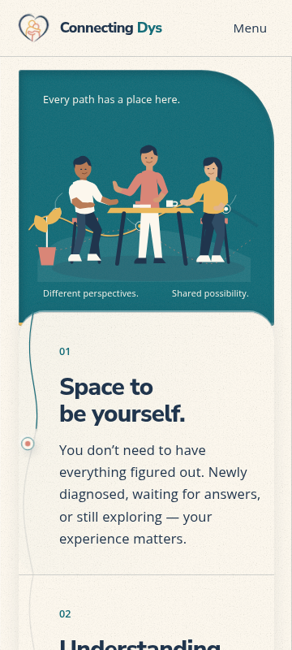
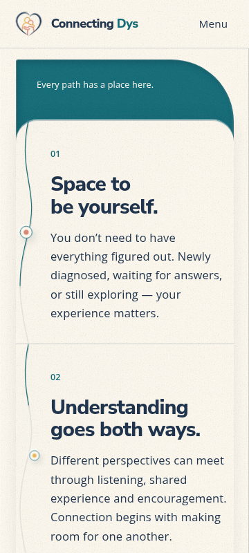

# Phase 04 evidence — 14 November 2026

Actual Chromium against the local production build; reference Phase 03 `4275c6ef4ad8617e40dc36da2dbaa42f84f00a35`. These are rendered application captures, not generated mock-ups or deployed-site screenshots.

[Full browser output](full-browser-results.txt) and [case-level results](browser-results.json): **91 passed, 11 intentional skips, zero failures or flaky tests**, 102 scenarios over six viewports, 8.5 minutes. The five duplicate ten-route audits run once at desktop; three portrait-only overlap cases skip desktop/tablet/landscape; the remaining three skips suppress connection/discovery/welcome animation on short landscape while static fallback/navigation still run.

| Viewport | Passed | Skipped |
| --- | ---: | ---: |
| Phone 360×800 | 16 | 1 |
| Phone 430×932 | 16 | 1 |
| Tablet 768×1024 | 15 | 2 |
| Desktop 1440×900 | 16 | 1 |
| Landscape 844×390 | 12 | 5 |
| Reflow 320×800 | 16 | 1 |

## The stacking reveal

These two captures are different scroll positions within one scene. Tests separately prove that the artwork's viewport Y stays within 1px while the first chapter moves upwards more than 50px, and that the chapter heading wins the overlap hit test. The effect pins only decorative artwork; meaningful text stays in document flow.

| First chapter arriving | First chapter overlapping |
| --- | --- |
|  |  |

[Desktop composition](desktop-connection.png) retains a measured art-only pin beside all three chapters. [Maximum-reading static alternative](mobile-spacious.png) shows ordinary-flow content with optional rails removed. [Measured geometry](measurements.json) records early/late path offsets, changed decorative node transforms, unchanged absolute text coordinates, zero overflow and portrait overlap measurements.

The full suite includes keyboard/anchor/Back/Forward, all five fonts/four backgrounds, maximum spacing, all three texture styles, style persistence after Off/reload/route changes, reset, OS/site reduced motion, forced colours, no-JS and repeated scene teardown/rebuild after mid-passage preference/orientation changes. Rendered axe finds no tagged WCAG A/AA violations on the homepage and ten public routes; no page/console errors are recorded in the scene smoke checks.

[Actual browser UI zoom](browser-zoom.json): zero horizontal document overflow at 200%/400% with Linen; zero dialog overflow at 400%; maximum OpenDyslexic size/spacing with Plaster at 400% also has zero page/dialog overflow and no pins. This is native desktop Chromium zoom, not a physical phone.

[Source/HTTP comparison](source-http-audit.json) records ten 200 routes with identical meaningful main text, links and image semantics, both unchanged logo hashes, texture resources and built-asset byte counts. Build, lint, typecheck, diff hygiene and 12 production regression groups pass. No new package, font or bitmap is added.

Reproduce: `npm run build`, `npm run lint`, `npm run typecheck`, `npm test`, `npm run test:browser`. The existing optional `PLAYWRIGHT_CHROMIUM_EXECUTABLE_PATH` and validated `PLAYWRIGHT_PORT` may select a local browser/port. This environment used native Terminal to launch Chromium because the command executor disallows its Unix sockets; application code/configuration is unchanged by that runner limitation.

Physical Android/iOS momentum, screen readers/VoiceOver, physical high-DPI inspection and Core Web Vitals remain release checks. No deployment, Vercel configuration or build-status lookup is performed. See [the implementation report](../../PHASE_04_CONNECTION_JOURNEY.md) for complete contracts and changed files.
